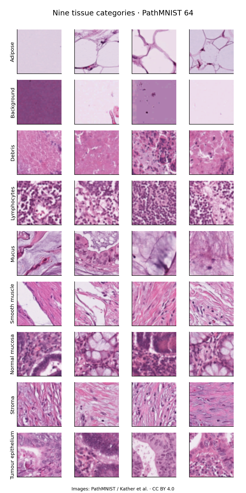
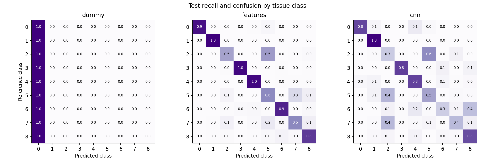
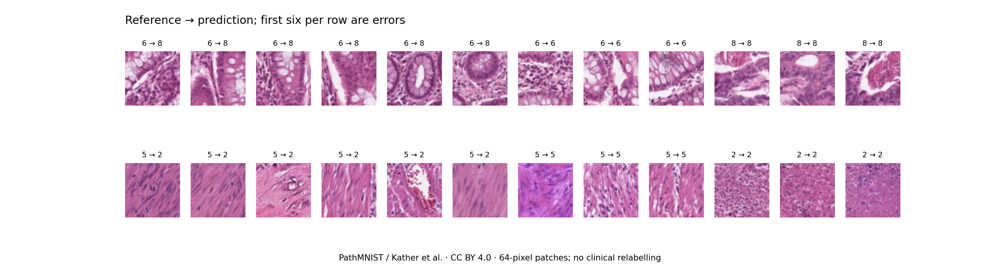

# Colorectal Tissue Classification

**Colour and texture features versus a small CNN on PathMNIST.**

I started with a visual question: which tissue categories can a few explicit image measurements distinguish, and what does a small convolutional network add? In this bounded experiment, the simpler feature model performed better. The interesting part is where the difference appears.



Images are 64 × 64 RGB PathMNIST patches, adapted from Kather and colleagues' colorectal histology collections, **CC BY 4.0**. This contact sheet uses four seeded examples per class, without selecting for visual neatness.

## A comparison with the same training data

I used 9,000 training patches—1,000 per class—and 1,800 validation patches from the official splits. The 7,180 test patches were evaluated only after model selection. An exact-image hash audit found no exclusions or duplicated test images; that does not establish patient independence.

| Model | Test macro F1 | Balanced accuracy | Overall accuracy |
|---|---:|---:|---:|
| Most-frequent class | 0.035 | 0.111 | 0.186 |
| 18 features + logistic regression | **0.801** | **0.802** | **0.856** |
| Small CNN | 0.623 | 0.623 | 0.686 |

The explicit features are RGB means and standard deviations, a uniform local-binary-pattern histogram, grayscale entropy and average edge magnitude. Training-only standardisation precedes L2 logistic regression. These are appearance measurements, not cell counts or validated biomarkers.

The CNN has three convolutional layers (16, 32 and 64 channels), two max-pooling layers and global average pooling. I fixed Adam at 0.001 and trained for eight epochs without augmentation; epoch 8 had the highest validation macro F1. I kept this result rather than searching for a stronger model after seeing the test scores.



Class indices: **0** adipose · **1** background · **2** debris · **3** lymphocytes · **4** mucus · **5** smooth muscle · **6** normal colon mucosa · **7** cancer-associated stroma · **8** colorectal adenocarcinoma epithelium. Rows are reference labels; columns are predictions.

## The mistakes are part of the result

The two largest CNN confusions were **normal mucosa → tumour epithelium (272 patches)** and **smooth muscle → debris (236)**. The error sheet shows six seeded mistakes per row followed by correctly classified examples of both involved classes.



In the first row, pale openings and densely stained regions occur across both correct and incorrect examples. In the second, pink tissue and differences in texture are visible across the groups. These observations suggest questions about spatial structure and limited resolution; they do not establish what the model uses internally or justify changing the supplied labels.

The feature model was correct on **1,460 test patches that the CNN missed**. [One fixed-index example](results/feature-wins-example.png) makes that disagreement inspectable. The conclusion is specific to these features, architecture, sample selection and training budget—not that CNNs are generally inferior for pathology.

## Reproduce or inspect

```bash
python -m venv .venv
source .venv/bin/activate
python -m pip install -r requirements.txt
python -m unittest discover -s tests
python analysis.py --download
```

The archive is approximately 1 GB; allow several GB of working space. Training runs on CPU with two PyTorch threads. [The notebook](analysis.ipynb) displays saved results and includes an explicit optional full rerun. The [protocol](protocol.md) documents the frozen design. Tables include split indices, per-patch predictions, per-class recall, training history and exact download/source checksums. Saved model files are generated locally by this code; load pickle-based files only from sources you trust.

## Scope and sources

These labels identify **tissue categories**, not cancer diagnoses, stages or patient outcomes. The packaged arrays do not supply the grouping needed for patient-level uncertainty estimates or a new patient-level split. I preserve the supplied split and report descriptive patch-level performance. This experiment does not reproduce the source paper's survival analysis or constitute a clinical tool.

- **Dataset and packaging:** [MedMNIST metadata](https://github.com/MedMNIST/MedMNIST/blob/main/medmnist/info.py), [PathMNIST archive](https://zenodo.org/records/10519652). PathMNIST is distributed under [CC BY 4.0](https://creativecommons.org/licenses/by/4.0/). Image figures here arrange the resized dataset patches with labels; they remain subject to that licence, separate from the MIT licence for my code.
- **Biological and image foundation:** Kather et al. (2019), [*Predicting survival from colorectal cancer histology slides using deep learning: A retrospective multicenter study*](https://doi.org/10.1371/journal.pmed.1002730), PLOS Medicine. The source collections are NCT-CRC-HE-100K and CRC-VAL-HE-7K.
- **Benchmark framework:** Yang et al. (2023), [*MedMNIST v2—A large-scale lightweight benchmark for 2D and 3D biomedical image classification*](https://doi.org/10.1038/s41597-022-01721-8).
- **Implementation:** scikit-image, scikit-learn, PyTorch, NumPy, pandas and Matplotlib. The comparison is an educational implementation, not a new architecture or a leaderboard claim.
